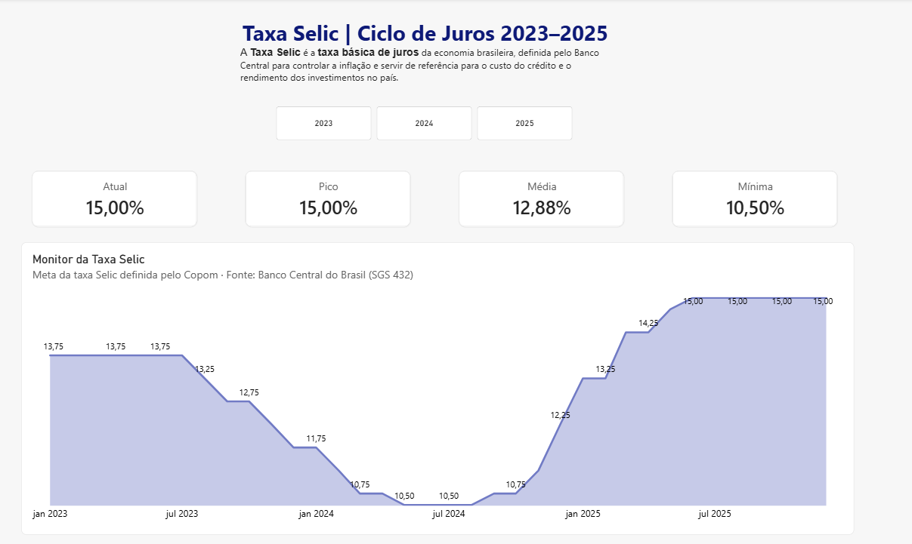

# 📈 Pipeline Selic

Pipeline de dados que coleta a **meta da taxa Selic** pela API do Banco Central,
processa os dados com Python, exporta para CSV e alimenta um dashboard no Power BI
com a análise do ciclo de juros de 2023 a 2025.



## 🔄 Fluxo do projeto

```
API Banco Central (SGS 432) → Python (coleta e tratamento) → selic.csv → Power BI (dashboard)
```

## 🛠️ Tecnologias

- **Python**: `requests` para consumir a API e `csv` para exportar os dados
- **API SGS do Banco Central**: série 432 (meta da taxa Selic)
- **Power BI**: Power Query para o tratamento e DAX para as medidas
- **Git e GitHub**: versionamento

## 📁 Estrutura

```
pipeline-selic/
├── main.py               # Coleta, análise e exportação dos dados
├── selic.csv             # Dados gerados pelo script
├── dashboard-selic.pbix  # Dashboard Power BI
├── dashboard.png         # Print do dashboard
├── requirements.txt      # Dependências do projeto
└── README.md
```

## ▶️ Como rodar

1. Clone o repositório:
   ```bash
   git clone https://github.com/SEU-USUARIO/pipeline-selic.git
   cd pipeline-selic
   ```
2. Instale as dependências:
   ```bash
   py -m pip install -r requirements.txt
   ```
3. Execute o script:
   ```bash
   py main.py
   ```
4. O arquivo `selic.csv` é gerado na pasta. Abra o `dashboard-selic.pbix` no Power BI
   Desktop e clique em **Atualizar**. Se necessário, ajuste o caminho do CSV na fonte de dados.

O período coletado pode ser alterado nas variáveis `data_inicial` e `data_final` do `main.py`.

## 📊 O que o dashboard mostra

- **Selic atual, pico, média e mínima** do período selecionado
- **Evolução mensal** da meta Selic, com o ciclo de cortes (13,75% → 10,50%) e o de altas (10,50% → 15,00%)
- **Filtro por ano** (2023, 2024 e 2025)

### Medidas DAX principais

```dax
Selic Atual =
VAR UltimaData = MAX ( selic[data] )
RETURN
    CALCULATE ( MAX ( selic[valor] ), selic[data] = UltimaData )
```

A medida retorna o valor do último dia disponível no contexto do filtro. No gráfico mensal,
isso representa a taxa vigente no fechamento de cada mês.

## 💡 Desafios e aprendizados

- **Consumo de API REST** e tratamento de respostas em JSON
- **Lógica de programação aplicada**: loops, condições, conversão de tipos e acumuladores
  para filtrar e calcular a média dos dados
- **Localidade no Power BI**: o CSV usa ponto como separador decimal (`13.75`), mas o
  Power BI em português interpretava como `1375`. Resolvido no Power Query com conversão
  de tipo usando a localidade **Inglês (EUA)** para a coluna de valores e **Português (Brasil)** para as datas.
- **Agregação correta**: os dados são diários, então somar por mês gerava valores
  incorretos (ex.: 426,25 = 13,75 × 31 dias). Resolvido com uma medida que retorna
  o valor do último dia do mês.

## 🚀 Próximos passos

- [ ] Organizar o código em funções
- [ ] Armazenar os dados em um banco PostgreSQL
- [ ] Automatizar a coleta diária com GitHub Actions
- [ ] Adicionar histórico das decisões do Copom (altas e cortes)

## 👤 Autor

**Murilo da Silva Santos**
[LinkedIn](https://www.linkedin.com/in/murilo-santos-796b60328/) · [GitHub](https://github.com/murilossx)